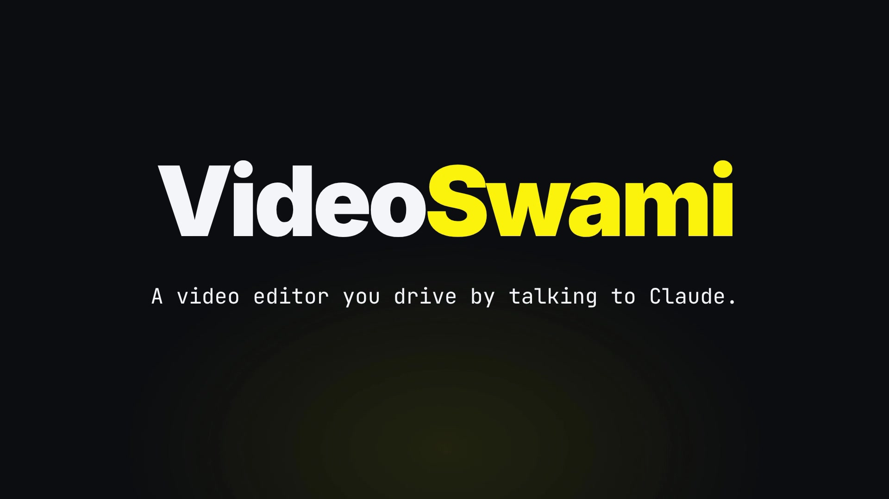
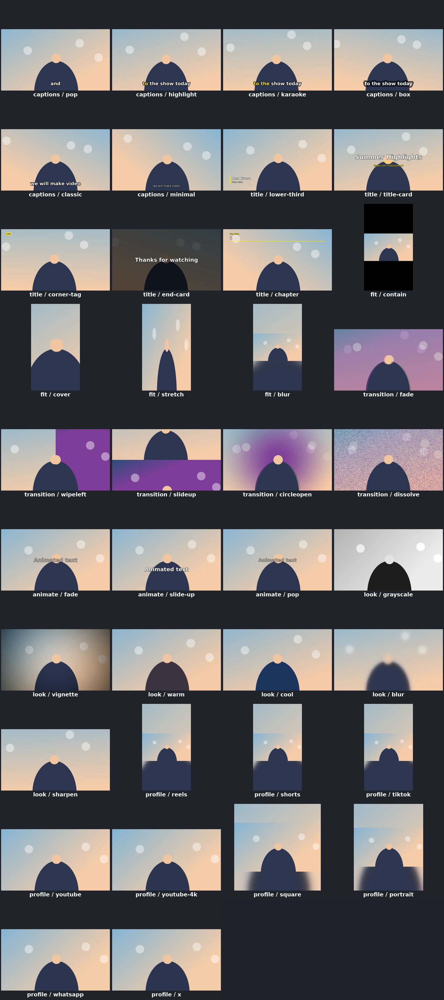

# VideoSwami

A video editor you drive by talking to Claude. Give Claude a video, say what you want, and it
plans the edit, renders it with ffmpeg, checks the frames, and hands back the file.

[](docs/media/videoswami-launch.mp4)

*Click the picture for the 22-second launch video. Music: Sascha Ende, ende.app (CC BY 4.0).*

VideoSwami is two things:

- **`videoswami`**: a command-line editor built on ffmpeg. Python 3.9+, standard library only.
- **A Claude skill** (`.claude/skills/videoswami/SKILL.md`) that teaches Claude Code how to use it.

## Requirements

- Python 3.9 or newer
- `ffmpeg` and `ffprobe` on PATH (`brew install ffmpeg`, `sudo apt install ffmpeg`, `winget install ffmpeg`)
- Optional: `pip install faster-whisper` for anything that needs to hear speech
- Optional: `pip install opencv-python` for face tracking in `reframe`

## Use it with Claude Code

Open this folder in Claude Code. The skill is picked up from `.claude/skills/`. Then just ask:

> Take interview.mp4, remove the part where I talk about pricing, make it vertical with captions.

To use it from any folder, copy `dist/videoswami.pyz` to `~/.videoswami/videoswami.pyz` and the
skill folder to `~/.claude/skills/videoswami/`.

## Use it yourself

```
python3 dist/videoswami.pyz <command> ...      # single file
python3 -m videoswami <command> ...            # from this folder
```

Every command prints one JSON object on its last line. `-o OUT` is required for anything that
writes a file, inputs are never modified, `--dry-run` shows the ffmpeg commands.

| Area | Commands |
|------|----------|
| Look and listen | `probe` `inspect` `frames` `silences` `scenes` `loudness` `transcribe` `find` `beats` |
| Cut and join | `trim` `cut` `keep` `concat` `split` `speed` `reverse` `remove-silence` |
| Speech editing | `cut-speech` `remove-fillers` `edit-text` |
| Framing and look | `resize` `crop` `rotate` `color` `stabilize` `denoise` `reframe` `enhance` `reference` `match` |
| Additions | `text` `watermark` `pip` `music` `subtitles` `captions` `title` `fade` |
| Sound | `mute` `volume` `normalize` `extract-audio` |
| Smart | `highlights` `beat-sync` `slideshow` |
| Output | `render` `validate` `export` `profiles` `compress` `convert` `gif` `thumbnail` |

Multi-step edits go in one JSON edit spec (timeline, overlays, captions, music) and render in a
single pass: `videoswami render edit.json -o out.mp4`. The full command and spec reference is in
[docs/SPEC.md](docs/SPEC.md).

## See the styles

[docs/VISUAL-GUIDE.md](docs/VISUAL-GUIDE.md) shows a picture of every caption style, title template, transition, fit, look and
export profile, each with the command that makes it. Regenerate it with `python3 tools/make_gallery.py`.



## Match a reference video

Point VideoSwami at a video or image whose look you like:

```
videoswami reference liked.mp4                       # measures colour, framing, cut pacing, loudness; writes a contact sheet
videoswami match mine.mp4 --reference liked.mp4 -o out.mp4
```

`match` transfers overall brightness, contrast, saturation and warmth, the loudness, and the frame shape and frame rate. It reports the
reference's cut pacing as a hint and does not copy exact hues or content. In an edit spec use `"look": {"reference": "liked.mp4"}`.


## ClipSwami: long video to short clips

ClipSwami is included as a sub-skill. In Claude Code: `/clipswami <video or link>` finds the best moments and returns finished vertical
clips with captions; `/clipswami-cut <video> <start> <end>` cuts one clip; `/clipswami-setup` installs its helpers. Engine:
`python3 -m clipswami --help`.

## Development

```
python3 tests/check.py          # core + one-shot commands
python3 tests/check2.py         # speech, smart edits, finishing
python3 tests/check3.py         # reference matching, visual guide
python3 -m unittest discover -s tests -p "test_clipswami.py"
python3 build.py                # rebuild dist/videoswami.pyz
```

The checks generate their own test clips with ffmpeg and verify real output (duration, size,
pixel colours, loudness).

## Known limits

- Real Whisper transcription has not been run in the build environment (no model download there).
  The adapters were checked against a stand-in backend and a mock of faster-whisper.
- Face tracking in `reframe` has not been tested on real faces; motion tracking has.
- All automated checks use synthetic clips.
