# Visual guide

A picture of every look VideoSwami offers, made by VideoSwami itself on a generated demo clip (a presenter on a soft gradient). Under each picture is the command or edit spec that makes it.

Regenerate everything with `python3 tools/make_gallery.py`.

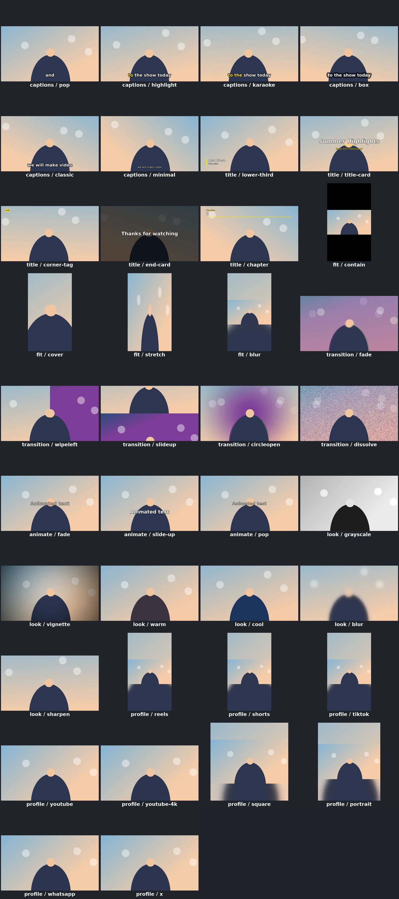

## Captions

Animated word-by-word captions, burned in. Each look is one `--style` value.

### pop

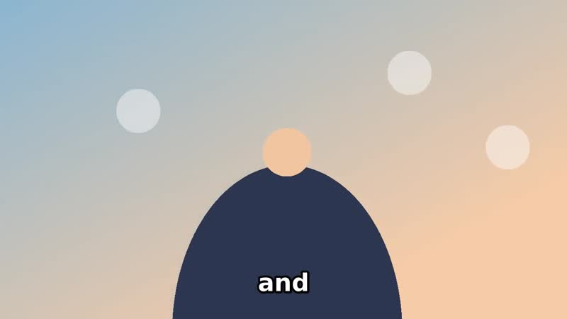

```bash
python3 -m videoswami captions demo.mp4 --transcript demo.transcript.json --style pop -o out.mp4
```

### highlight

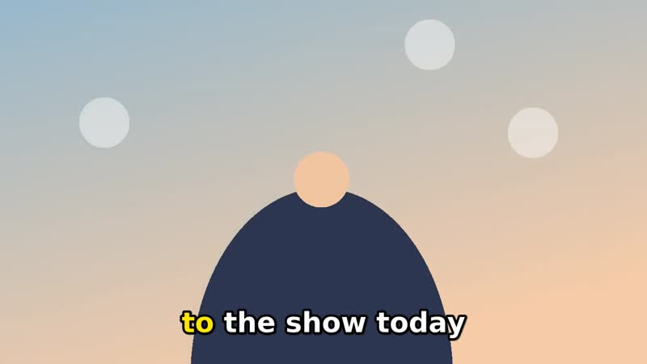

```bash
python3 -m videoswami captions demo.mp4 --transcript demo.transcript.json --style highlight -o out.mp4
```

### karaoke

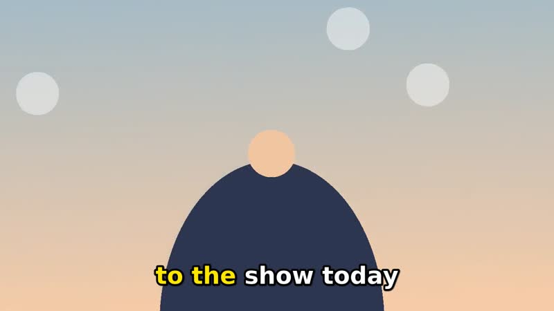

```bash
python3 -m videoswami captions demo.mp4 --transcript demo.transcript.json --style karaoke -o out.mp4
```

### box

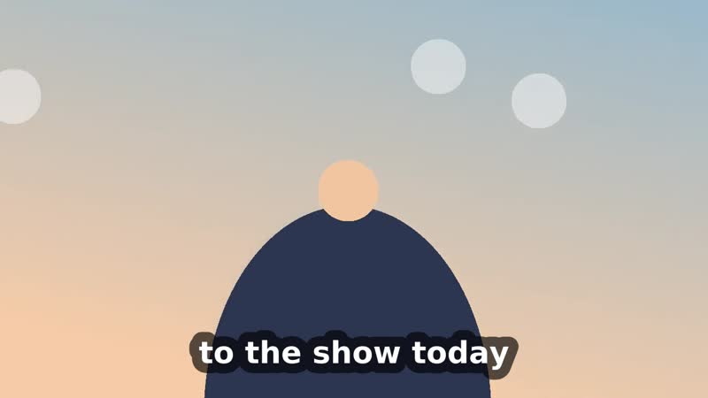

```bash
python3 -m videoswami captions demo.mp4 --transcript demo.transcript.json --style box -o out.mp4
```

### classic

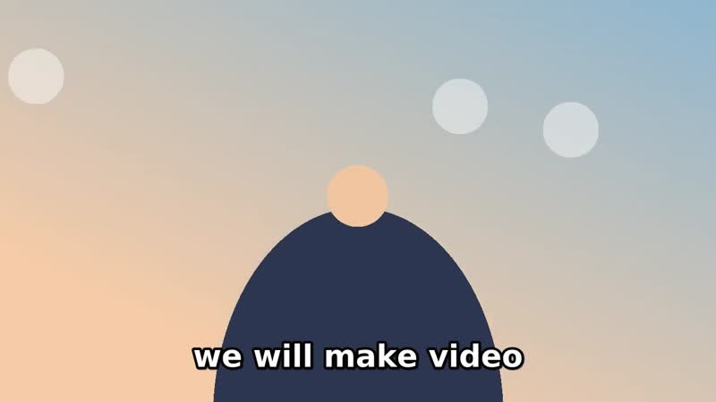

```bash
python3 -m videoswami captions demo.mp4 --transcript demo.transcript.json --style classic -o out.mp4
```

### minimal

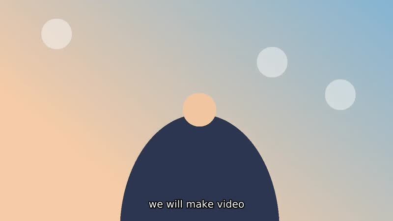

```bash
python3 -m videoswami captions demo.mp4 --transcript demo.transcript.json --style minimal -o out.mp4
```

## Title templates

Ready-made animated titles and name tags. No image files needed.

### lower-third


```bash
python3 -m videoswami title demo.mp4 --template lower-third --text "Alex Rivera" --sub "Video editor" --start 0.5 --end 5.5 -o out.mp4
```

### title-card


```bash
python3 -m videoswami title demo.mp4 --template title-card --text "Summer Highlights" --sub "Made with VideoSwami" --start 0.5 --end 5.5 -o out.mp4
```

### corner-tag

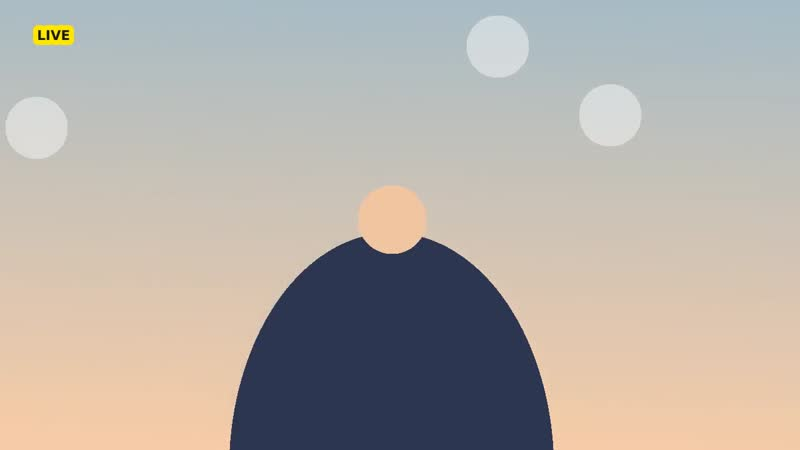

```bash
python3 -m videoswami title demo.mp4 --template corner-tag --text "LIVE" --start 0.5 --end 5.5 -o out.mp4
```

### end-card


```bash
python3 -m videoswami title demo.mp4 --template end-card --text "Thanks for watching" --start 0.5 --end 5.5 -o out.mp4
```

### chapter

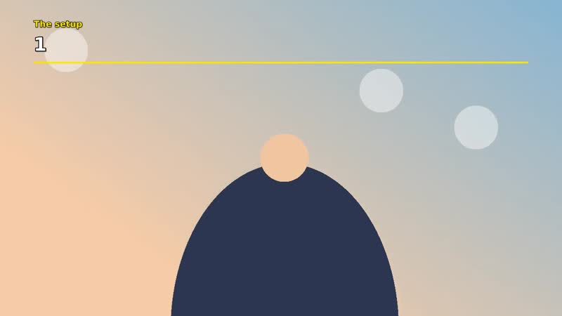

```bash
python3 -m videoswami title demo.mp4 --template chapter --text "1" --sub "The setup" --start 0.5 --end 5.5 -o out.mp4
```

## Fitting wide video into a tall frame

A 16:9 clip placed in a 9:16 frame. `fit` decides what happens to the edges.

### contain


Whole picture visible, empty bars (black here) above and below.

```json
{
  "output": {
    "width": 1080,
    "height": 1920
  },
  "timeline": [
    {
      "src": "demo.mp4",
      "fit": "contain"
    }
  ]
}
```

### cover

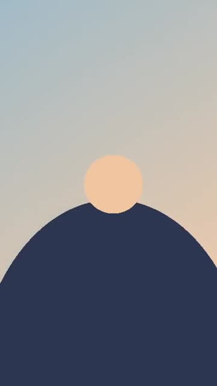

Fills the frame; the sides are cut off.

```json
{
  "output": {
    "width": 1080,
    "height": 1920
  },
  "timeline": [
    {
      "src": "demo.mp4",
      "fit": "cover"
    }
  ]
}
```

### stretch


Fills the frame by squashing the picture. Rarely what you want.

```json
{
  "output": {
    "width": 1080,
    "height": 1920
  },
  "timeline": [
    {
      "src": "demo.mp4",
      "fit": "stretch"
    }
  ]
}
```

### blur


Whole picture visible over a blurred copy of itself.

```json
{
  "output": {
    "width": 1080,
    "height": 1920
  },
  "timeline": [
    {
      "src": "demo.mp4",
      "fit": "blur"
    }
  ]
}
```

## Transitions

The frame in the middle of a one-second transition between two clips. Any ffmpeg `xfade` name works.

### fade


```json
{
  "timeline": [
    {
      "src": "a.mp4",
      "out": 3
    },
    {
      "src": "b.mp4",
      "out": 3,
      "transition": {
        "type": "fade",
        "duration": 1.0
      }
    }
  ]
}
```

### wipeleft


```json
{
  "timeline": [
    {
      "src": "a.mp4",
      "out": 3
    },
    {
      "src": "b.mp4",
      "out": 3,
      "transition": {
        "type": "wipeleft",
        "duration": 1.0
      }
    }
  ]
}
```

### slideup

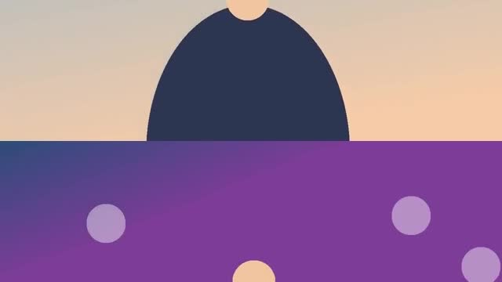

```json
{
  "timeline": [
    {
      "src": "a.mp4",
      "out": 3
    },
    {
      "src": "b.mp4",
      "out": 3,
      "transition": {
        "type": "slideup",
        "duration": 1.0
      }
    }
  ]
}
```

### circleopen


```json
{
  "timeline": [
    {
      "src": "a.mp4",
      "out": 3
    },
    {
      "src": "b.mp4",
      "out": 3,
      "transition": {
        "type": "circleopen",
        "duration": 1.0
      }
    }
  ]
}
```

### dissolve

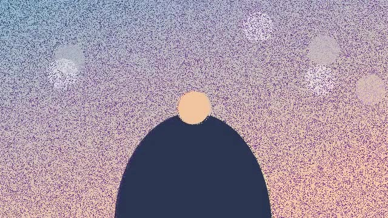

```json
{
  "timeline": [
    {
      "src": "a.mp4",
      "out": 3
    },
    {
      "src": "b.mp4",
      "out": 3,
      "transition": {
        "type": "dissolve",
        "duration": 1.0
      }
    }
  ]
}
```

## Text animation

The frame halfway through the text's entrance. Use `animate.in` and `animate.out` on any overlay.

### fade


```json
{
  "timeline": [
    {
      "src": "demo.mp4"
    }
  ],
  "overlays": [
    {
      "type": "text",
      "text": "Animated text",
      "start": 1,
      "end": 5,
      "x": "center",
      "y": "center",
      "size": 96,
      "color": "white",
      "bold": true,
      "outline": 3,
      "animate": {
        "in": "fade",
        "duration": 1.0
      }
    }
  ]
}
```

### slide-up


```json
{
  "timeline": [
    {
      "src": "demo.mp4"
    }
  ],
  "overlays": [
    {
      "type": "text",
      "text": "Animated text",
      "start": 1,
      "end": 5,
      "x": "center",
      "y": "center",
      "size": 96,
      "color": "white",
      "bold": true,
      "outline": 3,
      "animate": {
        "in": "slide-up",
        "duration": 1.0
      }
    }
  ]
}
```

### pop

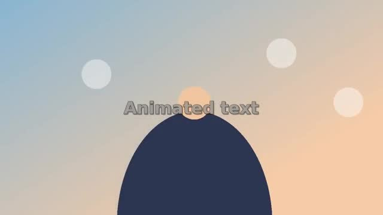

```json
{
  "timeline": [
    {
      "src": "demo.mp4"
    }
  ],
  "overlays": [
    {
      "type": "text",
      "text": "Animated text",
      "start": 1,
      "end": 5,
      "x": "center",
      "y": "center",
      "size": 96,
      "color": "white",
      "bold": true,
      "outline": 3,
      "animate": {
        "in": "pop",
        "duration": 1.0
      }
    }
  ]
}
```

## Looks and colour

Quick changes to how the picture feels.

### grayscale


```bash
python3 -m videoswami color demo.mp4 --grayscale --contrast 1.3 -o out.mp4
```

### vignette


```json
{
  "timeline": [
    {
      "src": "demo.mp4",
      "vignette": true
    }
  ]
}
```

### warm


```bash
python3 -m videoswami color demo.mp4 --temperature 0.6 -o out.mp4
```

### cool


```bash
python3 -m videoswami color demo.mp4 --temperature -0.6 -o out.mp4
```

### blur


```json
{
  "timeline": [
    {
      "src": "demo.mp4",
      "blur": 20
    }
  ]
}
```

### sharpen


```json
{
  "timeline": [
    {
      "src": "demo.mp4",
      "sharpen": 1.5
    }
  ]
}
```

## Export profiles

One picture per platform preset, showing the shape of the finished video.

### reels


1080x1920, 30 fps, loudness normalised.

```bash
python3 -m videoswami export demo.mp4 --profile reels -o out.mp4
```

### shorts


1080x1920, 30 fps, loudness normalised.

```bash
python3 -m videoswami export demo.mp4 --profile shorts -o out.mp4
```

### tiktok


1080x1920, 30 fps, loudness normalised.

```bash
python3 -m videoswami export demo.mp4 --profile tiktok -o out.mp4
```

### youtube


1920x1080.

```bash
python3 -m videoswami export demo.mp4 --profile youtube -o out.mp4
```

### youtube-4k


3840x2160.

```bash
python3 -m videoswami export demo.mp4 --profile youtube-4k -o out.mp4
```

### square


1080x1080.

```bash
python3 -m videoswami export demo.mp4 --profile square -o out.mp4
```

### portrait


1080x1350.

```bash
python3 -m videoswami export demo.mp4 --profile portrait -o out.mp4
```

### whatsapp


1280x720 at most, small file.

```bash
python3 -m videoswami export demo.mp4 --profile whatsapp -o out.mp4
```

### x


1280x720.

```bash
python3 -m videoswami export demo.mp4 --profile x -o out.mp4
```
